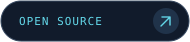
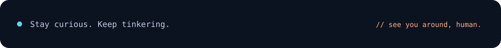

<div align="center">



<br />

**写代码，拆原理，偶尔也拆掉自己的 Bug。**

Rust & Go · Developer tools · Cybersecurity · Terminal things

<a href="https://userb1ank.github.io/"></a>
<a href="https://github.com/UserB1ank?tab=repositories"></a>

</div>

<br />

## 👾 Player info

Oi! Oi! Oi! 我是 **UserB1ank**，一个喜欢把好奇心写进代码的开发者。

现在的主力装备是 **Rust 和 Go**。喜欢造开发者工具、折腾终端，也喜欢研究网络安全。看到有趣的东西，第一反应通常是：**「让我看看它是怎么工作的。」**

| 🧑‍💻 写代码的时候 | 🎮 编辑器之外 |
| :--- | :--- |
| Rust / Go，和底层原理交朋友 | 游戏玩家，偶尔切换到摸鱼模式 |
| 开发者工具、终端应用、网络安全 | 80 年代复古风、蒸汽波、电子怀旧 |
| 喜欢把想法做成能运行的小东西 | 对有趣的新东西保持好奇 |

<br />

## 🦀 Two languages. Lots of possibilities.



<div align="center">

<sub>一个认真和编译器讲道理，一个把想法跑起来。两边都很好玩。</sub>

</div>

<br />

## 🛠️ Things I've built

| 项目 | 在折腾什么 | 装备 |
| :--- | :--- | :---: |
| [**LdapHound**](https://github.com/UserB1ank/LdapHound) | 离线读取 ADExplorer 快照，解析 AD 安全描述符，同时提供 GUI 和 CLI。 | `Rust` |
| [**ruscii_player**](https://github.com/UserB1ank/ruscii_player) | 把图片和视频变成真彩 ASCII，直接在终端里播放。 | `Rust` |
| [**interactive-process-mcp**](https://github.com/UserB1ank/interactive-process-mcp) | 给 AI Agent 接上交互式终端能力；后续开发已迁移至 termcp。 | `Go` |

<br />

## 📡 The commit room

<a href="https://github.com/UserB1ank?tab=overview">
  
</a>

<div align="center">

<sub>真实贡献数据 · 最近 12 个月 · 每日自动刷新</sub>

</div>

<br />

## 🐍 My commits, but make it a game

<picture>
  <source media="(prefers-color-scheme: dark)" srcset="https://raw.githubusercontent.com/UserB1ank/UserB1ank/output/snake-dark.svg" />
  <source media="(prefers-color-scheme: light)" srcset="https://raw.githubusercontent.com/UserB1ank/UserB1ank/output/snake.svg" />
  
</picture>

<div align="center">

<sub>今天写下的代码，明天就是小蛇的口粮。🦀</sub>

</div>

<br />

<details>
<summary><b>🎁 Secret inventory · 路过补给站</b></summary>

```rust
struct Developer {
    name: &'static str,
    main_languages: [&'static str; 2],
    curiosity: bool,
}

fn main() {
    let me = Developer {
        name: "UserB1ank",
        main_languages: ["Rust", "Go"],
        curiosity: true,
    };

    println!("Hi, I'm {}. Make yourself at home! 🐾", me.name);
}
```

```text
       /\_/\
      ( o.o )   +1 coffee
       > ^ <    +1 curiosity
               -1 mysterious bug (hopefully)
```

祝你今天的编译一次过，游戏不掉帧。谢谢你来串门！

</details>

<br />



<details>
<summary><sub>Visual notes & credits</sub></summary>

Custom SVG artwork and contribution dashboard for this profile. Contributions are read from GitHub by the daily [Profile visuals](https://github.com/UserB1ank/UserB1ank/actions/workflows/profile.yml) workflow.

Inspired by [DenverCoder1's profile](https://github.com/DenverCoder1/DenverCoder1) and the [Awesome GitHub Profile README](https://github.com/abhisheknaiidu/awesome-github-profile-readme) gallery. Contribution snake by [Platane/snk](https://github.com/Platane/snk). Language marks from [Simple Icons](https://github.com/simple-icons/simple-icons), CC0.

</details>
